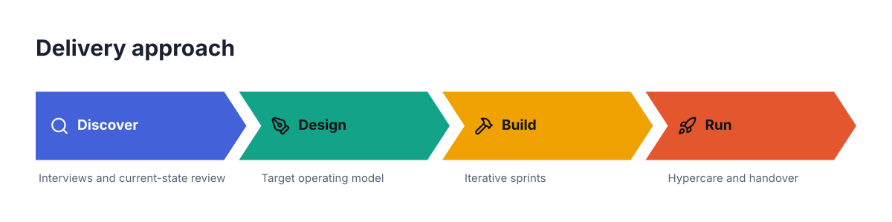
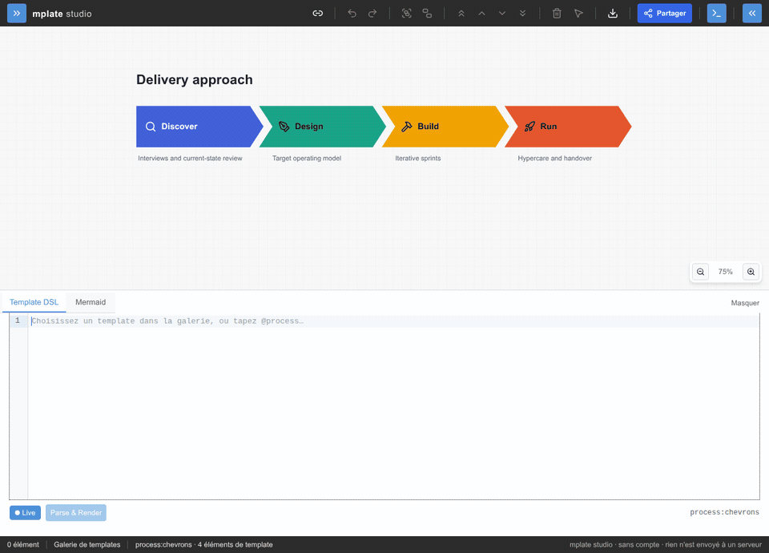
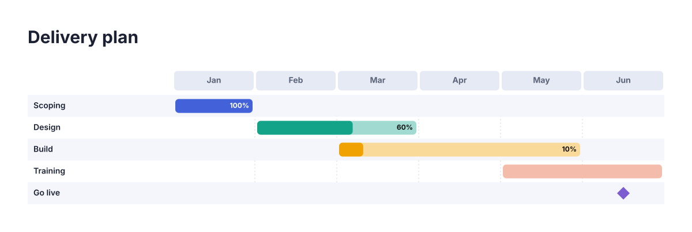
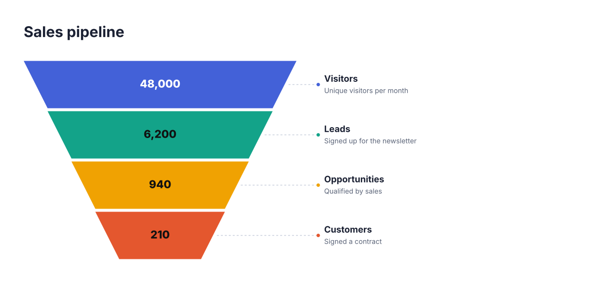
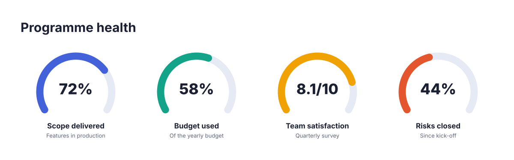
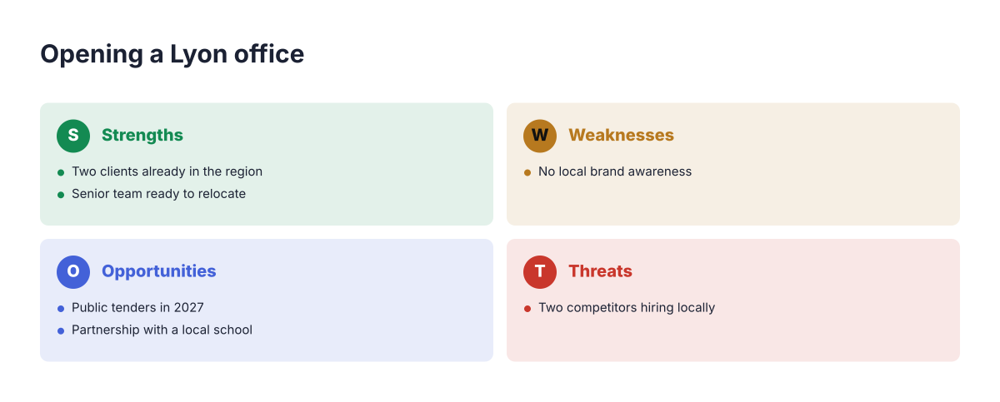
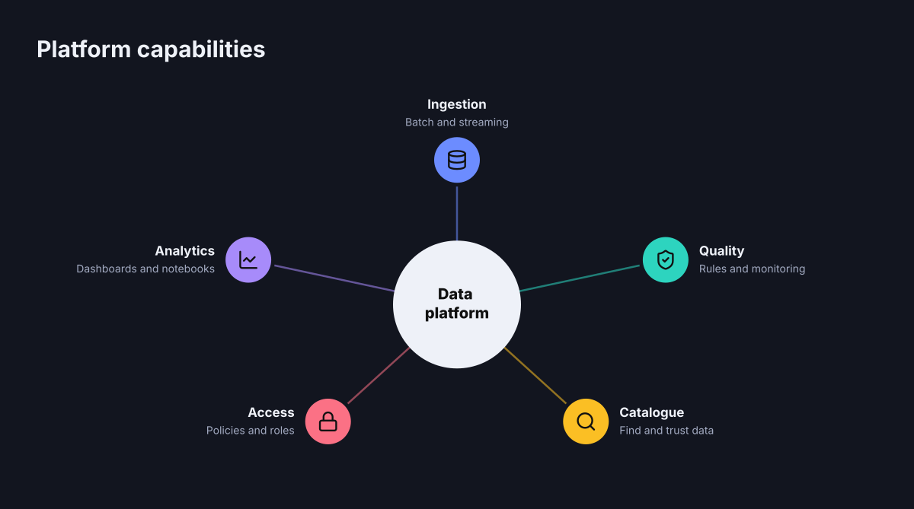

# mplate

[English](README.md) · Français

**Des infographies de qualité designer à partir de quelques lignes de texte.** Écrivez une ligne par élément ; mplate génère un visuel propre, fidèle à votre charte, qui se réagence automatiquement de 1 à N éléments. Conçu pour être le format écrit par les assistants IA.

```mplate
@process style:chevrons "Delivery approach"
  step "Discover" "Interviews and current-state review" icon:search
  step "Design" "Target operating model" icon:pen-tool
  step "Build" "Iterative sprints" icon:hammer
  step "Run" "Hypercare and handover" icon:rocket
```



Ajoutez une cinquième ligne `step` et les chevrons se resserrent ; ajoutez-en une douzième et ils passent sur plusieurs rangées. Vous n'avez jamais rien à positionner manuellement.

- **Templates paramétriques** : chaque template accepte une plage d'éléments et recalcule sa mise en page, ses tailles de texte et ses retours à la ligne.
- **Thématisable** : les templates ne contiennent ni couleur ni police codées en dur. Ils lisent les jetons de thème : un seul kit de marque suffit pour tout restyler.
- **Pensé pour l'IA** : une grammaire compacte et tolérante avec des diagnostics précis, et un [serveur MCP](docs/mcp.md) (en anglais) pour que Claude et d'autres assistants puissent générer des visuels directement.
- **SVG autonome** : zéro dépendance d'exécution, fonctionne sous Node.js et dans le navigateur. Export PNG optionnel.

## Essayer dans le navigateur

Le **[studio mplate](https://etcomment.github.io/mplate_core/)** est un éditeur gratuit et open source : choisissez un template, saisissez le DSL dans le tiroir de code, puis ajustez sur le canevas (déplacer, redimensionner, recolorer, éditer le texte), ajoutez des formes, des icônes ou un diagramme Mermaid, exportez en SVG, PNG ou JPG, et partagez via un lien. Aucun compte requis, et le design n'est jamais envoyé à un serveur. Lancez-le en local avec `npm install && npm run studio:dev`, ou ouvrez directement le [studio hébergé sur GitHub Pages](https://etcomment.github.io/mplate_core/).



## Installation

```bash
npm install @mplate/core         # bibliothèque + CLI + serveur MCP
npm install @resvg/resvg-js      # optionnel, pour l'export PNG
```

## Utilisation

**CLI**

```bash
npx mplate render roadmap.mplate -o roadmap.svg
npx mplate render roadmap.mplate --theme dark -o roadmap.png
npx mplate list                     # tous les templates
npx mplate describe funnel          # fiche d'identité d'un template
npx mplate validate roadmap.mplate  # erreurs et avertissements avec numéros de ligne
```

**Bibliothèque**

```ts
import { render } from '@mplate/core'

const { svg, diagnostics } = render(`@funnel "Sales pipeline"
  level "Visitors" val:"48,000"
  level "Leads" val:"6,200"
  level "Customers" val:"210"`, { theme: 'ocean' })
```

**MCP (Claude Desktop, Claude Code, tout client MCP)**

```json
{ "mcpServers": { "mplate": { "command": "npx", "args": ["-y", "-p", "@mplate/core", "mplate-mcp"] } } }
```

Demandez ensuite : *« Dessine notre feuille de route T3 sous forme de timeline mplate. »* Voir [docs/mcp.md](docs/mcp.md) (en anglais).

## Templates

25 templates répartis en 13 familles — processus (`process`), frise chronologique (`timeline` : axe, vertical, couloirs, Gantt), entonnoir (`funnel`), pyramide (`pyramid`), cycle (`cycle`), carte mentale (`brain`), cartes (`cards`), indicateurs (`kpi` : tuiles, jauges), comparatif (`comparison` : colonnes, tableau), matrice (`matrix` : 2×2, SWOT), organigramme (`org`), pile d'architecture (`stack`) et diagramme de Venn (`venn`). Catalogue complet avec exemples : [docs/templates.md](docs/templates.md) (en anglais).

| | |
| --- | --- |
|  |  |

| | | |
| --- | --- | --- |
|  |  |  |

## Le langage en 30 secondes

```mplate
@<family> [style:<name>] "Title"
  subtitle "Optional subtitle"
  theme dark palette:"#0b4f6c,#01baef,#20bf55"
  <element> "title" "subtitle" val:"€4.2M" pct:72 icon:rocket date:"Q3 2027" #e4572e
    <child> "text" yes
```

Documentation complète (en anglais) : [référence du DSL](docs/dsl.md) · [thèmes](docs/theming.md) · [ajustements manuels](docs/adjustments.md) · [kits de marque](docs/brand-kits.md) · [templates personnalisés](docs/authoring-templates.md#5-use-your-own-templates).

## Structure du dépôt

| Chemin | Paquet |
| --- | --- |
| [`packages/core`](packages/core) | `@mplate/core` — DSL, moteur, templates, CLI, serveur MCP |
| [`apps/studio`](apps/studio) | studio mplate — éditeur web sans compte |

## État du projet

Version préliminaire (`0.x`) : la grammaire et les identifiants de templates peuvent encore évoluer. Le moteur est volontairement léger et sans dépendance. La feuille de route et les décisions d'architecture se trouvent dans [`project/`](project/README.md) (en anglais).

## Contribuer

Les issues et pull requests sont les bienvenues — consultez [CONTRIBUTING.md](CONTRIBUTING.md) (en anglais). Les contributions sont acceptées sous le [Developer Certificate of Origin](https://developercertificate.org/) (`git commit -s`).

## Licence

[Apache 2.0](LICENSE). Icônes issues de [Lucide](https://lucide.dev) (ISC), voir [THIRD_PARTY_NOTICES.md](THIRD_PARTY_NOTICES.md).
