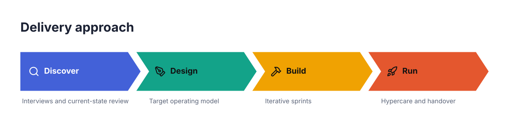
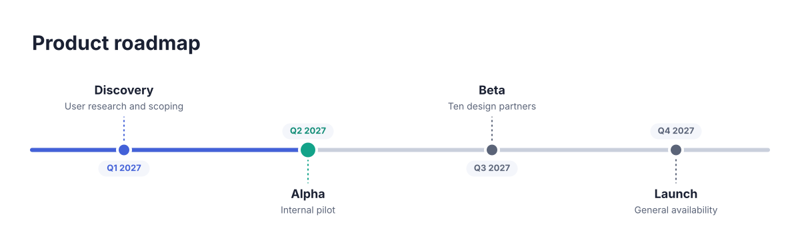
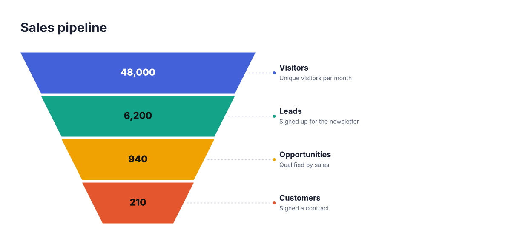
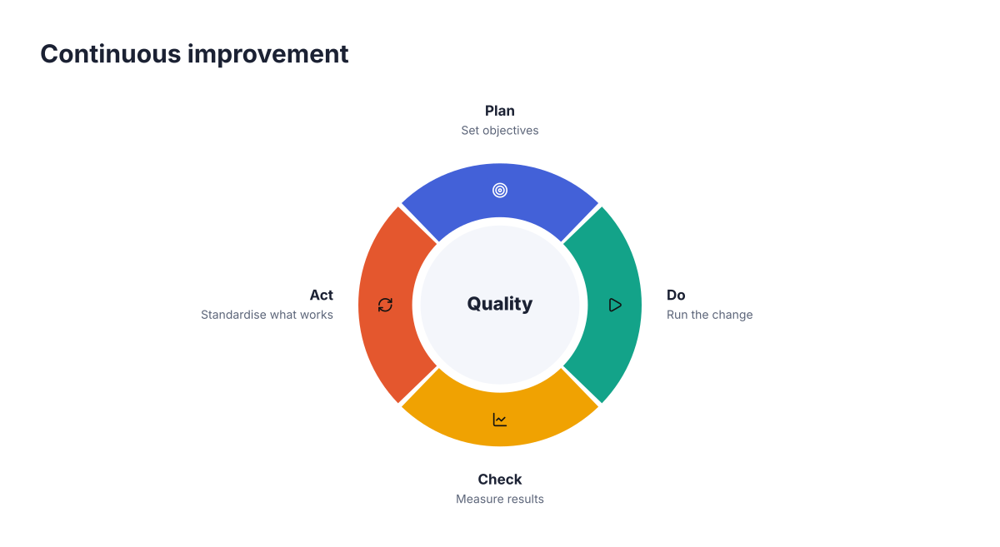
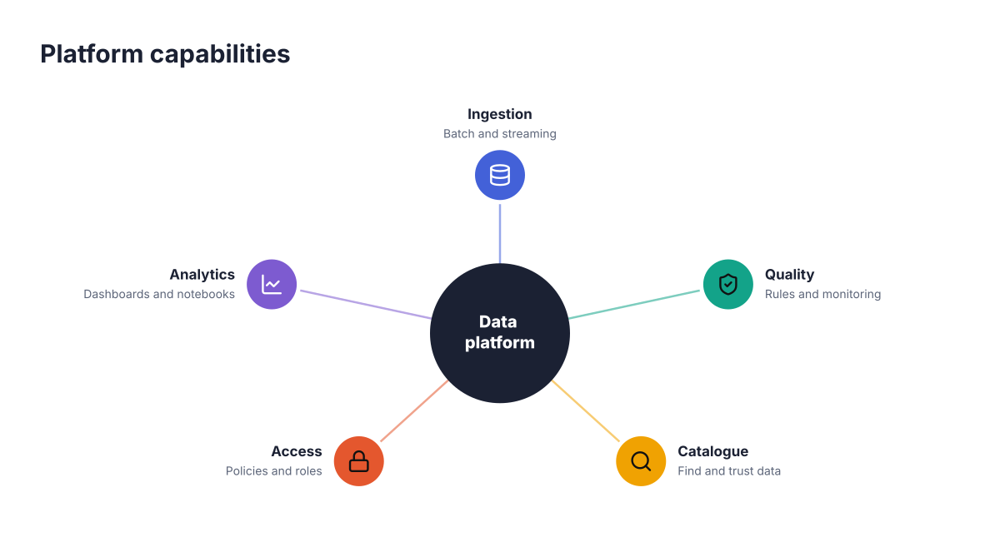
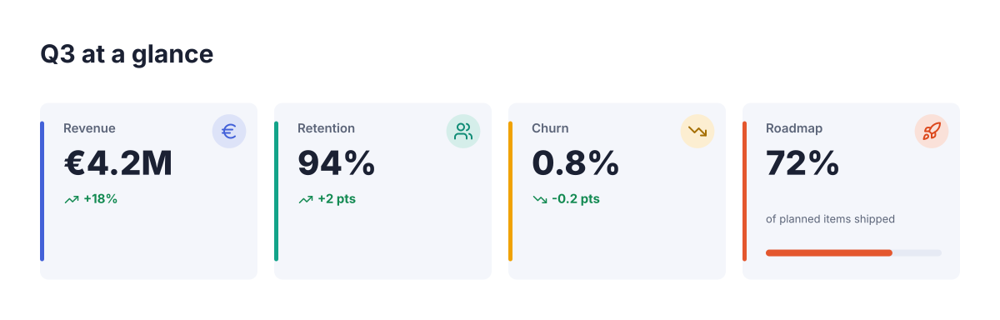
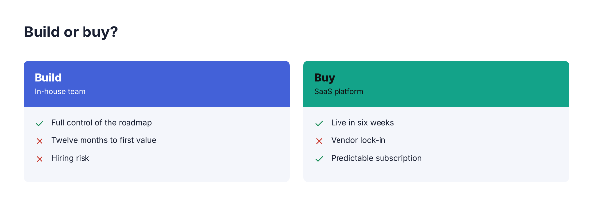
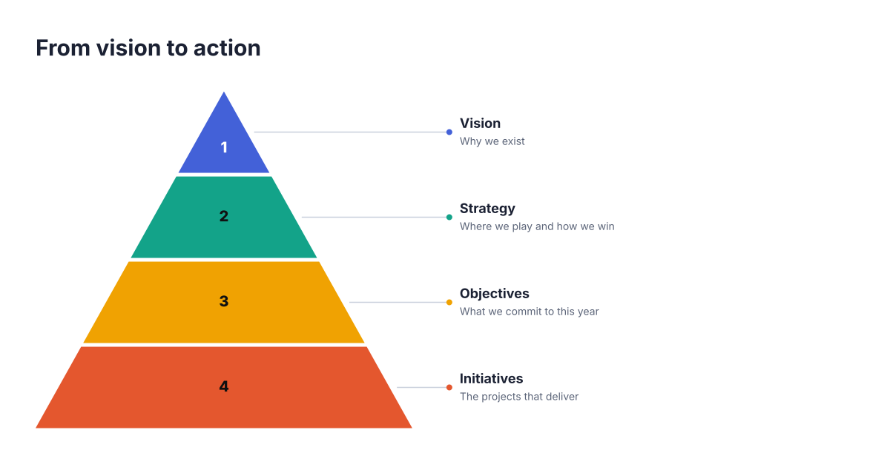
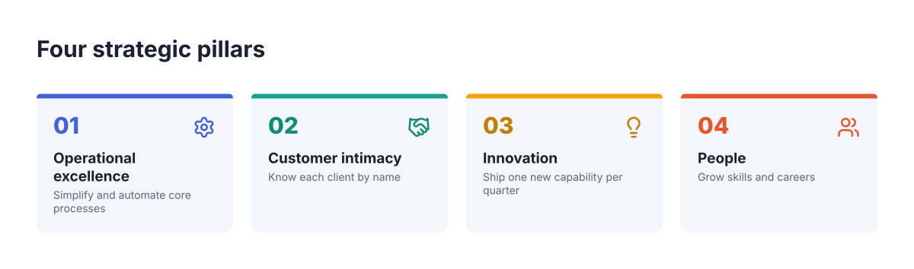
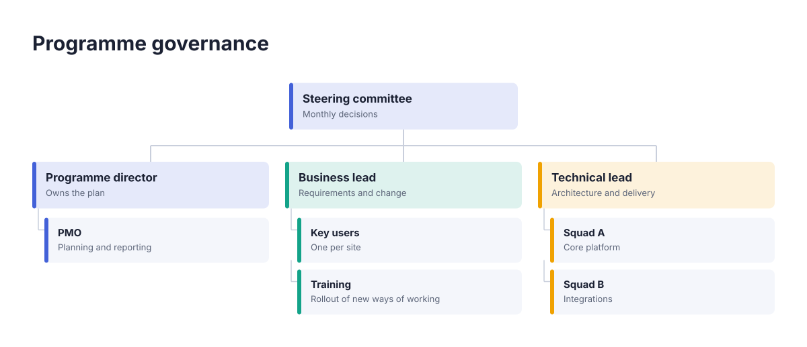

# mplate

**Designer-grade infographics from a few lines of text.** Write one line per element; mplate draws a clean, on-brand visual that re-flows by itself from 1 to N elements. Built to be the format AI assistants write.

```mplate
@process style:chevrons "Delivery approach"
  step "Discover" "Interviews and current-state review" icon:search
  step "Design" "Target operating model" icon:pen-tool
  step "Build" "Iterative sprints" icon:hammer
  step "Run" "Hypercare and handover" icon:rocket
```



Add a fifth `step` line and the chevrons narrow; add a twelfth and they wrap onto rows. You never position anything.

- **Parametric templates**: every template accepts a range of elements and recomputes its layout, text sizes and wrapping.
- **Themeable**: templates contain no hard-coded colours or fonts. They read theme tokens, so one brand kit restyles everything.
- **AI-native**: a tiny, forgiving grammar with precise diagnostics, and an [MCP server](docs/mcp.md) so Claude and other assistants can render visuals directly.
- **Standalone SVG**: zero runtime dependencies, runs in Node and the browser. Optional PNG export.

## Install

```bash
npm install mplate-core          # library + CLI + MCP server
npm install @resvg/resvg-js      # optional, for PNG export
```

## Use it

**CLI**

```bash
npx mplate render roadmap.mplate -o roadmap.svg
npx mplate render roadmap.mplate --theme dark -o roadmap.png
npx mplate list                     # all templates
npx mplate describe funnel          # identity card of one template
npx mplate validate roadmap.mplate  # errors and warnings with line numbers
```

**Library**

```ts
import { render } from 'mplate-core'

const { svg, diagnostics } = render(`@funnel "Sales pipeline"
  level "Visitors" val:"48,000"
  level "Leads" val:"6,200"
  level "Customers" val:"210"`, { theme: 'ocean' })
```

**MCP (Claude Desktop, Claude Code, any MCP client)**

```json
{ "mcpServers": { "mplate": { "command": "npx", "args": ["-y", "-p", "mplate-core", "mplate-mcp"] } } }
```

Then ask: *“Draw our Q3 roadmap as an mplate timeline.”* See [docs/mcp.md](docs/mcp.md).

## Templates

14 templates in 11 families — process, timeline, funnel, pyramid, cycle, brain (mind map), cards, KPI, comparison, matrix and org chart. Full catalogue with examples: [docs/templates.md](docs/templates.md).

| | | |
| --- | --- | --- |
|  |  |  |
|  |  |  |
|  |  |  |

## The language in 30 seconds

```mplate
@<family> [style:<name>] "Title"
  subtitle "Optional subtitle"
  theme dark palette:"#0b4f6c,#01baef,#20bf55"
  <element> "title" "subtitle" val:"€4.2M" pct:72 icon:rocket date:"Q3 2027" #e4572e
    <child> "text" yes
```

Full reference: [docs/dsl.md](docs/dsl.md) · Theming: [docs/theming.md](docs/theming.md) · Writing a template: [docs/authoring-templates.md](docs/authoring-templates.md).

## Project status

Early (`0.x`): the grammar and template ids may still change. The engine is deliberately small and dependency-free. Roadmap and design decisions live in [`project/`](project/README.md).

## Contributing

Issues and pull requests are welcome — read [CONTRIBUTING.md](CONTRIBUTING.md). Contributions are accepted under the [Developer Certificate of Origin](https://developercertificate.org/) (`git commit -s`).

## Licence

[Apache 2.0](LICENSE). Icons from [Lucide](https://lucide.dev) (ISC), see [THIRD_PARTY_NOTICES.md](THIRD_PARTY_NOTICES.md).
