# Template catalogue

Generated by `npm run gallery` from the identity cards in `packages/core/src/templates`. Do not edit by hand.

25 templates in 13 families.

| Template | Elements | Good for |
| --- | --- | --- |
| `process:chevrons` | 1–20 | delivery phases, customer journey, project lifecycle |
| `process:steps` | 1–24 | how it works, onboarding steps, method overview |
| `process:vertical` | 1–20 | procedure, method with detailed steps, onboarding checklist |
| `process:loop` | 1–10 | sprint cycle, continuous delivery loop, feedback loop |
| `timeline:axis` | 1–10 | project roadmap, company history, release plan |
| `timeline:vertical` | 1–30 | detailed plan, changelog, meeting agenda |
| `timeline:swimlanes` | 1–8 | product roadmap by team, programme plan by workstream, portfolio view |
| `timeline:gantt` | 1–30 | project schedule, release plan, phasing of a programme |
| `funnel:stack` | 1–10 | sales pipeline, conversion, prioritisation from many to few |
| `funnel:bars` | 1–12 | sales conversion, recruitment pipeline, adoption funnel |
| `pyramid:layers` | 1–8 | hierarchy of needs, maturity levels, strategy from vision to actions |
| `cycle:ring` | 1–10 | continuous improvement, product lifecycle, operating rhythm |
| `cycle:orbit` | 1–10 | customer lifecycle, learning loop, annual planning cycle |
| `brain:spokes` | 1–10 | capabilities around a product, stakeholder map, brainstorm summary |
| `brain:arc` | 1–12 | pillars of a strategy, workstreams of a programme, benefits of an offer |
| `cards:grid` | 1–30 | strategic pillars, services, key messages, team values |
| `kpi:tiles` | 1–24 | executive dashboard, quarterly results, project health |
| `kpi:gauges` | 1–18 | project completion, objectives reached, survey scores |
| `comparison:columns` | 1–4 | option analysis, before / after, pros and cons, offer tiers |
| `comparison:table` | 1–30 | offer tiers, vendor comparison, capability matrix |
| `matrix:quadrant` | 1–4 | prioritisation (impact / effort), SWOT, positioning map |
| `matrix:swot` | 1–40 | strategic analysis, project review, market entry |
| `org:tree` | 1–8 | organisation chart, project governance, work breakdown structure |
| `stack:layers` | 1–10 | application architecture, capability map, technology stack |
| `venn:circles` | 1–3 | sweet spot, skills overlap, product–market fit |

## Chevron process — `process:chevrons`

Sequential stages drawn as interlocking arrows, with a description under each stage. Wraps onto several rows beyond five stages.

- Header: `@process  or  @process style:chevrons` (aliases: @process1)
- Elements: 1 to 20 (best with 3 to 6)
- Good for: delivery phases; customer journey; project lifecycle

Element lines:
- `step "title" "subtitle"` (aliases: stage, phase): One stage of the process

Example:

```mplate
@process style:chevrons "Delivery approach"
  step "Discover" "Interviews and current-state review" icon:search
  step "Design" "Target operating model" icon:pen-tool
  step "Build" "Iterative sprints" icon:hammer
  step "Run" "Hypercare and handover" icon:rocket
```

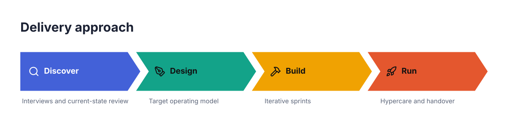

## Numbered steps — `process:steps`

Numbered (or iconed) circles on a connecting line, with title and description below each step.

- Header: `@process style:steps` (aliases: @process2)
- Elements: 1 to 24 (best with 3 to 6)
- Good for: how it works; onboarding steps; method overview

Element lines:
- `step "title" "subtitle"` (aliases: stage, phase): One step

Example:

```mplate
@process style:steps "How it works"
  step "Write" "One line per element"
  step "Render" "The layout adapts to the count"
  step "Theme" "Apply your brand tokens"
  step "Export" "SVG for slides and documents"
```


## Vertical steps — `process:vertical`

Steps stacked top to bottom with a numbered badge, a connecting line and room for long descriptions. A figure (val:) is shown on the right.

- Header: `@process style:vertical` (aliases: @process3)
- Elements: 1 to 20 (best with 3 to 8)
- Good for: procedure; method with detailed steps; onboarding checklist

Element lines:
- `step "title" "subtitle" "value"` (aliases: stage, phase): One step

Example:

```mplate
@process style:vertical "Incident procedure"
  step "Detect" "Monitoring raises an alert or a user calls the service desk" val:"5 min"
  step "Qualify" "Assess impact and urgency, open a ticket with the right priority" val:"15 min"
  step "Resolve" "Apply the known fix or escalate to the expert team" val:"4 h"
  step "Close" "Confirm with the user and record the root cause" val:"1 day"
```

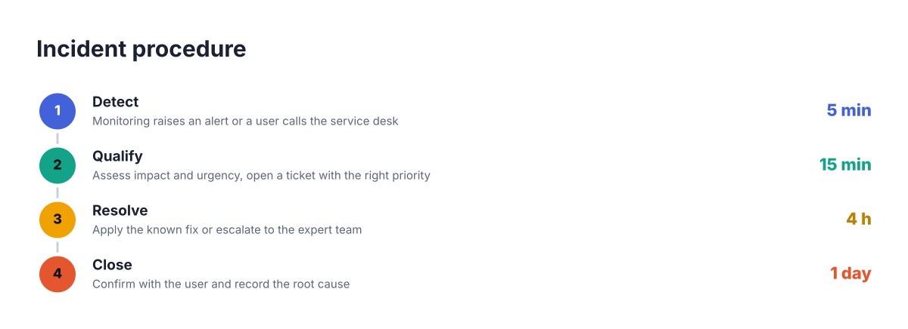

## Process loop — `process:loop`

Steps on a closed track: left to right on the top, back right to left on the bottom, so the last step leads into the first.

- Header: `@process style:loop` (aliases: @process4)
- Elements: 1 to 10 (best with 4 to 8)
- Good for: sprint cycle; continuous delivery loop; feedback loop

Element lines:
- `step "title" "subtitle"` (aliases: stage, phase): One step, in order around the loop

Settings (at most once):
- `center "text"`: Label in the middle of the loop

Example:

```mplate
@process style:loop "Sprint cycle"
  center "Two weeks"
  step "Plan" "Pick the sprint goal"
  step "Build" "Develop and test"
  step "Review" "Demo to stakeholders"
  step "Improve" "Retrospective"
```

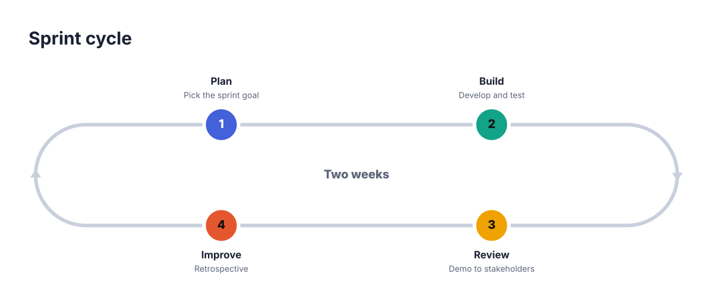

## Horizontal timeline — `timeline:axis`

Milestones on a horizontal axis, alternating above and below, with the date on the axis. Flag a milestone `done` or `current` to show progress.

- Header: `@timeline  or  @timeline style:axis` (aliases: @roadmap, @timeline1)
- Elements: 1 to 10 (best with 4 to 7)
- Good for: project roadmap; company history; release plan

Element lines:
- `milestone "title" "subtitle"` (aliases: event, step): One dated milestone — flags: done, current

Example:

```mplate
@timeline style:axis "Product roadmap"
  milestone "Discovery" "User research and scoping" date:"Q1 2027" done
  milestone "Alpha" "Internal pilot" date:"Q2 2027" current
  milestone "Beta" "Ten design partners" date:"Q3 2027"
  milestone "Launch" "General availability" date:"Q4 2027"
```

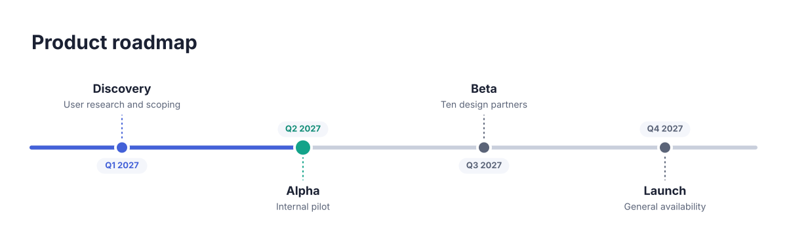

## Vertical timeline — `timeline:vertical`

Dates on the left, milestones on the right of a vertical line. Handles long lists (up to 30 entries).

- Header: `@timeline style:vertical` (aliases: @timeline2)
- Elements: 1 to 30 (best with 4 to 12)
- Good for: detailed plan; changelog; meeting agenda

Element lines:
- `milestone "title" "subtitle"` (aliases: event, step): One dated milestone — flags: done, current

Example:

```mplate
@timeline style:vertical "Workshop agenda"
  milestone "Welcome" "Goals of the day" date:09:00 done
  milestone "Current state" "What works, what hurts" date:09:30 current
  milestone "Target state" "Design in small groups" date:11:00
  milestone "Plan" "Owners and next steps" date:14:00
```


## Swimlane roadmap — `timeline:swimlanes`

One lane per team or workstream, periods as columns, milestones as cards in the right cell. Indent milestones under their lane.

- Header: `@timeline style:swimlanes` (aliases: @roadmap-lanes, @productroadmap)
- Elements: 1 to 8 (best with 2 to 5)
- Good for: product roadmap by team; programme plan by workstream; portfolio view

Element lines:
- `lane "title" "subtitle"` (aliases: team, stream, workstream): One lane; its milestones are indented below it
  - `milestone "title" "subtitle"` (aliases: item, event): A milestone in a period of the lane (date: one of the periods) (indented under lane)

Settings (at most once):
- `periods "period" "…"`: Column labels in order; milestones refer to them with date:

Example:

```mplate
@timeline style:swimlanes "Roadmap 2027"
  periods "Q1" "Q2" "Q3" "Q4"
  lane "Product"
    milestone "Discovery" "Interviews" date:Q1
    milestone "Beta" "Ten customers" date:Q3
  lane "Platform"
    milestone "New API" date:Q2
    milestone "Scale-out" date:Q4
  lane "Sales"
    milestone "Pilot offer" date:Q2
    milestone "Launch" date:Q4
```

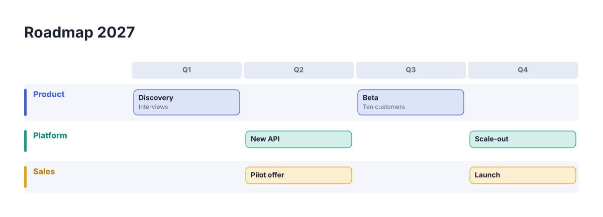

## Gantt chart — `timeline:gantt`

Tasks as bars across periods, from: and to: name the first and last period. pct: shows progress; the flag milestone draws a diamond.

- Header: `@timeline style:gantt` (aliases: @gantt)
- Elements: 1 to 30 (best with 4 to 15)
- Good for: project schedule; release plan; phasing of a programme

Element lines:
- `task "title"` (aliases: bar, activity): One task from a period to a period (from:, to:) — flags: milestone

Settings (at most once):
- `periods "period" "…"`: Column labels in order (months, sprints, quarters)

Example:

```mplate
@timeline style:gantt "Delivery plan"
  periods "Jan" "Feb" "Mar" "Apr" "May" "Jun"
  task "Scoping" from:Jan to:Jan pct:100
  task "Design" from:Feb to:Mar pct:60
  task "Build" from:Mar to:May pct:10
  task "Training" from:May to:Jun
  task "Go live" from:Jun milestone
```

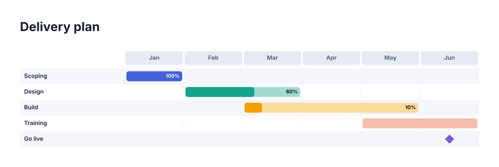

## Stacked funnel — `funnel:stack`

Narrowing layers with the key figure inside each layer and the explanation on the right.

- Header: `@funnel  or  @funnel style:stack` (aliases: @funnel1)
- Elements: 1 to 10 (best with 3 to 6)
- Good for: sales pipeline; conversion; prioritisation from many to few

Element lines:
- `level "title" "subtitle" "value"` (aliases: stage, layer): One funnel layer, widest first

Example:

```mplate
@funnel "Sales pipeline"
  level "Visitors" "Unique visitors per month" val:"48,000"
  level "Leads" "Signed up for the newsletter" val:"6,200"
  level "Opportunities" "Qualified by sales" val:"940"
  level "Customers" "Signed a contract" val:"210"
```

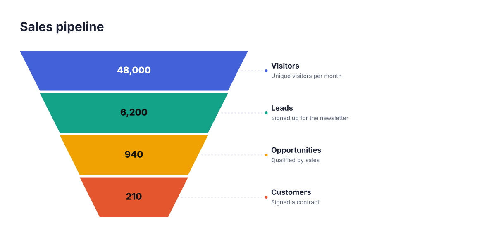

## Conversion bars — `funnel:bars`

One horizontal bar per stage, sized by its figure (val: or pct:), with the conversion rate from one stage to the next.

- Header: `@funnel style:bars` (aliases: @funnel2, @conversion)
- Elements: 1 to 12 (best with 3 to 7)
- Good for: sales conversion; recruitment pipeline; adoption funnel

Element lines:
- `level "title" "subtitle" "value"` (aliases: stage, step): One stage with its figure in val: (or pct:)

Example:

```mplate
@funnel style:bars "Recruitment pipeline"
  level "Applications" val:"1,240"
  level "Screened" val:"410"
  level "Interviewed" val:"96"
  level "Offers" val:"18"
  level "Hired" val:"14"
```

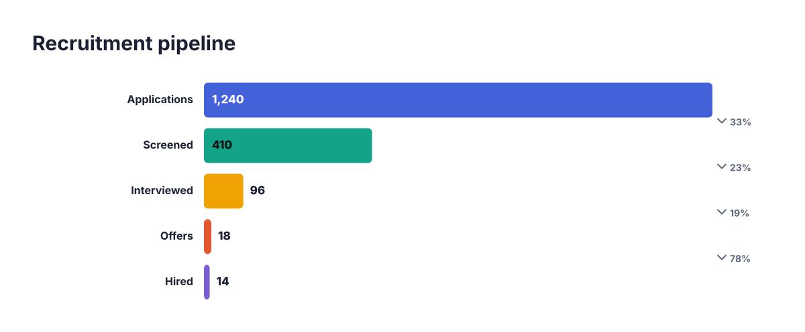

## Layered pyramid — `pyramid:layers`

A pyramid split into horizontal layers, top layer first, with explanations aligned on the right.

- Header: `@pyramid  or  @pyramid style:layers` (aliases: @pyramid1)
- Elements: 1 to 8 (best with 3 to 5)
- Good for: hierarchy of needs; maturity levels; strategy from vision to actions

Element lines:
- `layer "title" "subtitle" "value"` (aliases: level, tier): One layer, from the top (narrowest) to the base

Example:

```mplate
@pyramid "From vision to action"
  layer "Vision" "Why we exist"
  layer "Strategy" "Where we play and how we win"
  layer "Objectives" "What we commit to this year"
  layer "Initiatives" "The projects that deliver"
```

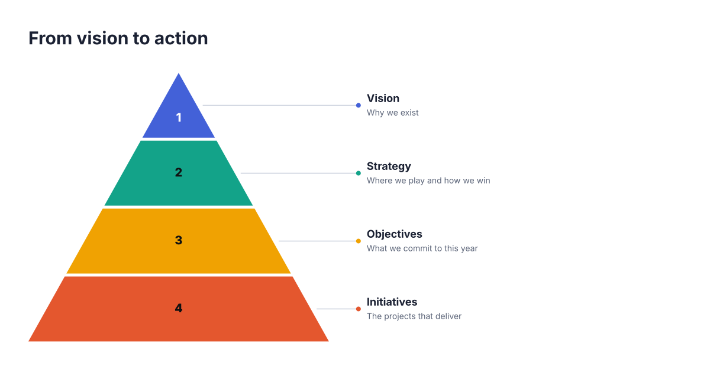

## Ring cycle — `cycle:ring`

A ring split into equal segments around a central label, for continuous or repeating processes.

- Header: `@cycle  or  @cycle style:ring` (aliases: @circle, @cycle1)
- Elements: 1 to 10 (best with 3 to 6)
- Good for: continuous improvement; product lifecycle; operating rhythm

Element lines:
- `segment "title" "subtitle"` (aliases: step, stage): One segment of the cycle, clockwise from the top

Settings (at most once):
- `center "text"`: Text in the middle of the ring

Example:

```mplate
@cycle "Continuous improvement"
  center "Quality"
  segment "Plan" "Set objectives" icon:target
  segment "Do" "Run the change" icon:play
  segment "Check" "Measure results" icon:chart-line
  segment "Act" "Standardise what works" icon:refresh-cw
```

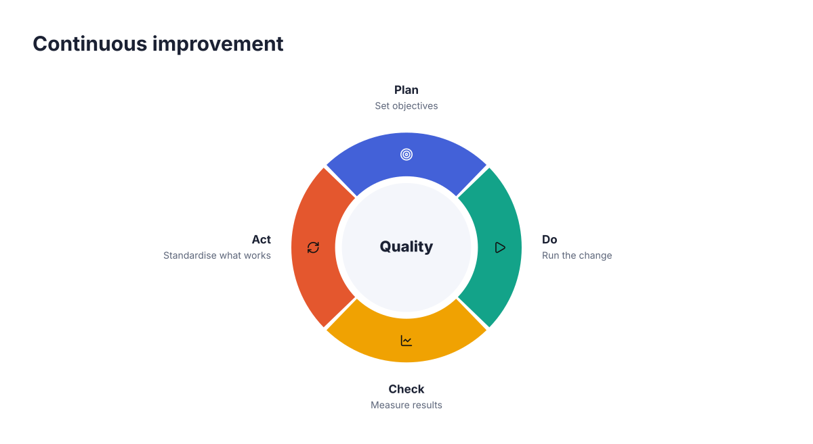

## Orbit cycle — `cycle:orbit`

Stages as badges on a circular track with arrows showing the direction, around a central label. Lighter than the ring for long labels.

- Header: `@cycle style:orbit` (aliases: @cycle2)
- Elements: 1 to 10 (best with 4 to 8)
- Good for: customer lifecycle; learning loop; annual planning cycle

Element lines:
- `stage "title" "subtitle"` (aliases: step, segment): One stage, clockwise from the top

Settings (at most once):
- `center "text"`: Text in the middle

Example:

```mplate
@cycle style:orbit "Customer lifecycle"
  center "Customer"
  stage "Discover" "Finds us through content" icon:search
  stage "Try" "Free studio, no account" icon:play
  stage "Adopt" "Team plan and brand kit" icon:users
  stage "Expand" "More teams, more kits" icon:trending-up
  stage "Advocate" "Shares visuals publicly" icon:megaphone
```

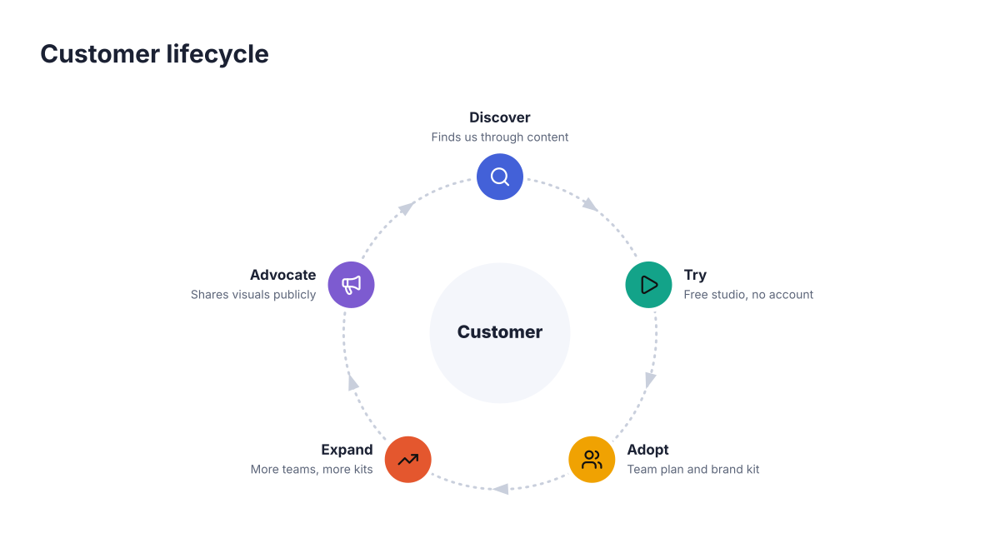

## Hub and spokes — `brain:spokes`

A central idea with related ideas arranged all around it.

- Header: `@brain  or  @brain style:spokes` (aliases: @brain1, @hub, @mindmap)
- Elements: 1 to 10 (best with 4 to 8)
- Good for: capabilities around a product; stakeholder map; brainstorm summary

Element lines:
- `node "title" "subtitle"` (aliases: idea, branch, topic): One idea connected to the centre

Settings (at most once):
- `center "text"`: The central idea

Example:

```mplate
@brain style:spokes "Platform capabilities"
  center "Data platform"
  node "Ingestion" "Batch and streaming" icon:database
  node "Quality" "Rules and monitoring" icon:shield-check
  node "Catalogue" "Find and trust data" icon:search
  node "Access" "Policies and roles" icon:lock
  node "Analytics" "Dashboards and notebooks" icon:chart-line
```

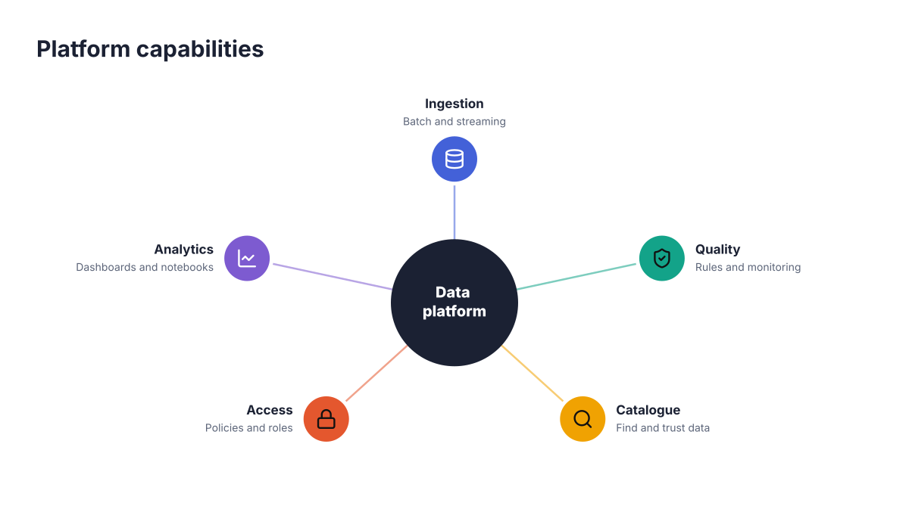

## Hub with arc — `brain:arc`

A central idea on the left with related ideas fanned out along an arc to the right. Reads well with long descriptions.

- Header: `@brain style:arc` (aliases: @brain2)
- Elements: 1 to 12 (best with 3 to 7)
- Good for: pillars of a strategy; workstreams of a programme; benefits of an offer

Element lines:
- `node "title" "subtitle"` (aliases: idea, branch, topic): One idea connected to the centre

Settings (at most once):
- `center "text"`: The central idea

Example:

```mplate
@brain style:arc "Why customers choose us"
  center "Our offer"
  node "Fast" "Live in two weeks, not two quarters" icon:zap
  node "Simple" "One line of text per element" icon:sparkles
  node "On brand" "Your colours and fonts everywhere" icon:palette
  node "Open" "Apache 2.0 engine you can self-host" icon:globe
```


## Card grid — `cards:grid`

Numbered cards in a balanced grid with an accent bar, icon, title and description. Good default for lists of 2 to 30 items.

- Header: `@cards  or  @cards style:grid` (aliases: @strategy, @pillars, @cards1)
- Elements: 1 to 30 (best with 3 to 8)
- Good for: strategic pillars; services; key messages; team values

Element lines:
- `card "title" "subtitle"` (aliases: block, pillar, item): One card

Example:

```mplate
@cards "Four strategic pillars"
  card "Operational excellence" "Simplify and automate core processes" icon:settings
  card "Customer intimacy" "Know each client by name" icon:handshake
  card "Innovation" "Ship one new capability per quarter" icon:lightbulb
  card "People" "Grow skills and careers" icon:users
```

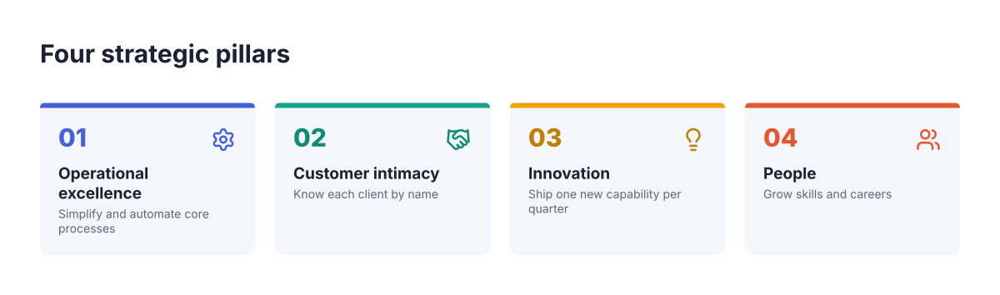

## KPI tiles — `kpi:tiles`

Metric tiles with a label, a large value, a coloured change indicator and an optional progress bar (pct:). Use the flags `good` or `bad` when a negative change is good news.

- Header: `@kpi  or  @kpi style:tiles` (aliases: @dashboard, @metrics, @kpi1)
- Elements: 1 to 24 (best with 3 to 8)
- Good for: executive dashboard; quarterly results; project health

Element lines:
- `metric "title" "value" "delta" "subtitle"` (aliases: kpi, stat): One metric — flags: good, bad

Example:

```mplate
@kpi "Q3 at a glance"
  metric "Revenue" "€4.2M" "+18%" icon:euro
  metric "Retention" "94%" "+2 pts" icon:users
  metric "Churn" "0.8%" "-0.2 pts" good icon:trending-down
  metric "Roadmap" "72%" pct:72 sub:"of planned items shipped" icon:rocket
```

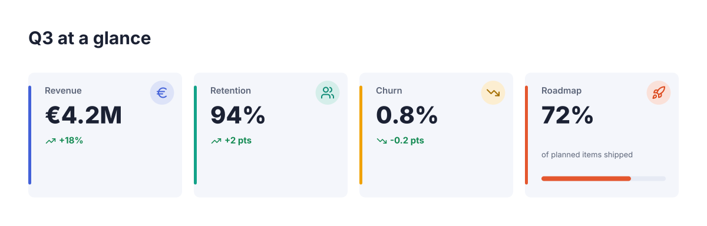

## Gauges — `kpi:gauges`

Radial gauges filled to pct:, with the figure in the centre and a label below. Ideal for completion, satisfaction or targets reached.

- Header: `@kpi style:gauges` (aliases: @gauges, @kpi2)
- Elements: 1 to 18 (best with 3 to 6)
- Good for: project completion; objectives reached; survey scores

Element lines:
- `gauge "title" "subtitle" "value"` (aliases: metric, kpi): One gauge; pct: sets the fill (0–100)

Example:

```mplate
@kpi style:gauges "Programme health"
  gauge "Scope delivered" "Features in production" pct:72
  gauge "Budget used" "Of the yearly budget" pct:58
  gauge "Team satisfaction" "Quarterly survey" pct:81 val:"8.1/10"
  gauge "Risks closed" "Since kick-off" pct:44
```

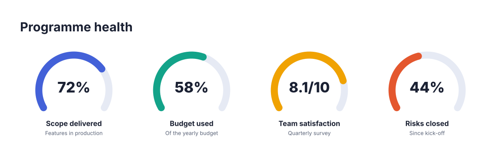

## Comparison columns — `comparison:columns`

Two to four options side by side, each with a coloured header and a list of points. Mark points with `yes` or `no` for ticks and crosses.

- Header: `@comparison  or  @comparison style:columns` (aliases: @compare, @versus, @comparison1)
- Elements: 1 to 4 (best with 2 to 3)
- Good for: option analysis; before / after; pros and cons; offer tiers

Element lines:
- `column "title" "subtitle"` (aliases: option, side): One option; its points are indented below it
  - `point "title"` (aliases: item, bullet): One point of the option — flags: yes, pro, plus, no, con, minus (indented under column)

Example:

```mplate
@comparison "Build or buy?"
  column "Build" "In-house team"
    point "Full control of the roadmap" yes
    point "Twelve months to first value" no
    point "Hiring risk" no
  column "Buy" "SaaS platform"
    point "Live in six weeks" yes
    point "Vendor lock-in" no
    point "Predictable subscription" yes
```

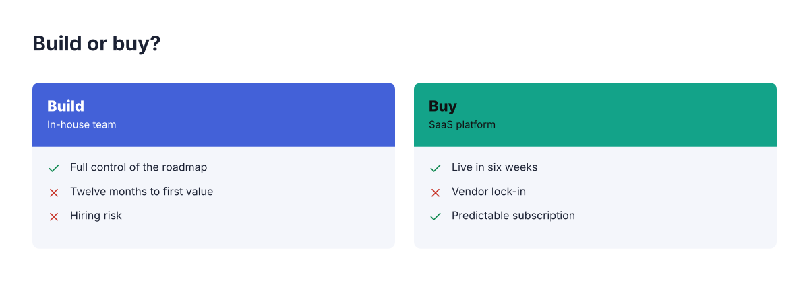

## Feature table — `comparison:table`

A comparison matrix: options as columns, one row per criterion. Cells accept yes, no, partial or any short text. highlight names the recommended column.

- Header: `@comparison style:table` (aliases: @features, @comparison2)
- Elements: 1 to 30 (best with 4 to 12)
- Good for: offer tiers; vendor comparison; capability matrix

Element lines:
- `row "title"` (aliases: feature, criterion): One criterion followed by one value per column (yes, no, partial or text)

Settings (at most once):
- `columns "option" "…"`: The options compared, in order
- `highlight "option"`: The recommended option

Example:

```mplate
@comparison style:table "Which plan?"
  columns "Free" "Pro" "Team"
  highlight "Team"
  row "Unlimited visuals" yes yes yes
  row "Brand kit" no partial yes
  row "PowerPoint export" no yes yes
  row "Members" "1" "1" "Up to 25"
```

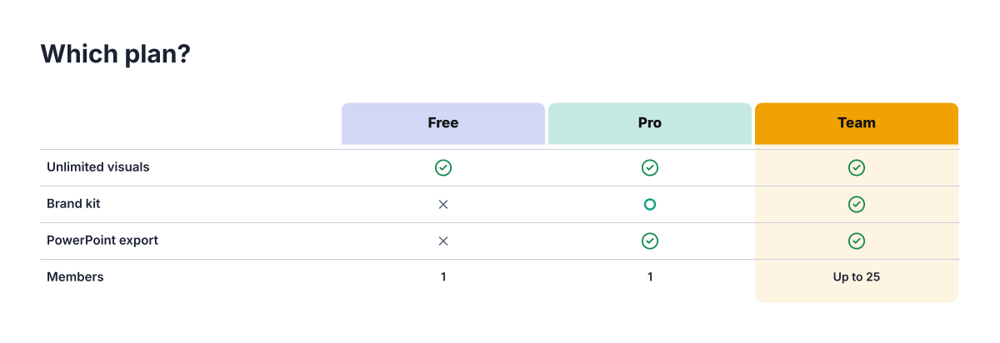

## 2×2 matrix — `matrix:quadrant`

Four quadrants on two labelled axes, filled top-left, top-right, bottom-left, bottom-right. Indent items under a quadrant to list them inside it.

- Header: `@matrix  or  @matrix style:quadrant` (aliases: @matrix2x2, @quadrant)
- Elements: 1 to 4 (best with 4 to 4)
- Good for: prioritisation (impact / effort); SWOT; positioning map

Element lines:
- `quadrant "title" "subtitle"` (aliases: zone, box): One quadrant, in reading order
  - `item "title"` (aliases: point, bullet): One entry listed inside the quadrant (indented under quadrant)

Settings (at most once):
- `x "name" "low" "high"`: Horizontal axis: name, then optional low and high labels
- `y "name" "low" "high"`: Vertical axis: name, then optional low and high labels

Example:

```mplate
@matrix "Prioritisation"
  x "Effort" "Low" "High"
  y "Impact" "Low" "High"
  quadrant "Quick wins" "Do now"
    item "Self-service export"
  quadrant "Big bets" "Plan carefully"
    item "New data platform"
  quadrant "Fill-ins" "When time allows"
  quadrant "Money pits" "Avoid"
```


## SWOT — `matrix:swot`

Strengths, weaknesses, opportunities and threats in four boxes. Write one line per point; each keyword sends the point to its box. labels renames the boxes.

- Header: `@matrix style:swot` (aliases: @swot)
- Elements: 1 to 40 (best with 8 to 16)
- Good for: strategic analysis; project review; market entry

Element lines:
- `strength "title"` (aliases: strengths, s): A point in Strengths
- `weakness "title"` (aliases: weaknesses, w): A point in Weaknesses
- `opportunity "title"` (aliases: opportunities, o): A point in Opportunities
- `threat "title"` (aliases: threats, t): A point in Threats

Settings (at most once):
- `labels "strengths" "weaknesses" "opportunities" "threats"`: Box titles in order S, W, O, T (to translate them)

Example:

```mplate
@matrix style:swot "Opening a Lyon office"
  strength "Two clients already in the region"
  strength "Senior team ready to relocate"
  weakness "No local brand awareness"
  opportunity "Public tenders in 2027"
  opportunity "Partnership with a local school"
  threat "Two competitors hiring locally"
```

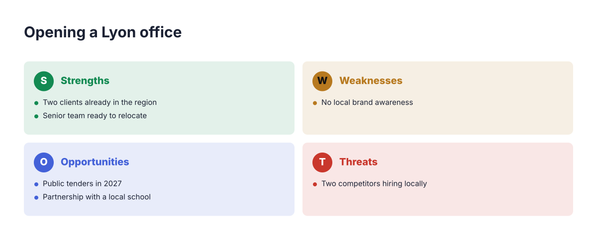

## Organisation chart — `org:tree`

A top unit, a row of direct reports and, under each of them, their teams as a compact indented column. Indentation in the DSL defines the hierarchy.

- Header: `@org  or  @org style:tree` (aliases: @orgchart, @organigram, @org1)
- Elements: 1 to 8 (best with 1 to 1)
- Good for: organisation chart; project governance; work breakdown structure

Element lines:
- `unit "title" "subtitle"` (aliases: person, team, role): One box of the chart; indent units under it to create reports
  - `unit` lines can be indented under each other to any depth

Example:

```mplate
@org "Programme governance"
  unit "Steering committee" "Monthly decisions"
    unit "Programme director" "Owns the plan"
      unit "PMO" "Planning and reporting"
    unit "Business lead" "Requirements and change"
      unit "Key users" "One per site"
      unit "Training" "Rollout of new ways of working"
    unit "Technical lead" "Architecture and delivery"
      unit "Squad A" "Core platform"
      unit "Squad B" "Integrations"
```

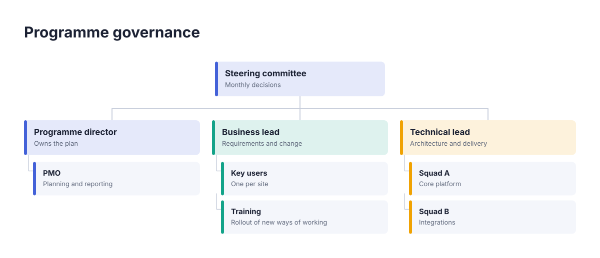

## Layered stack — `stack:layers`

Horizontal layers from top to bottom, each with its components as chips that wrap onto several lines. Indent components under their layer.

- Header: `@stack  or  @stack style:layers` (aliases: @architecture, @layers, @stack1)
- Elements: 1 to 10 (best with 3 to 6)
- Good for: application architecture; capability map; technology stack

Element lines:
- `layer "title" "subtitle"` (aliases: tier, level): One layer; its components are indented below it
  - `component "title"` (aliases: item, block, app): One component of the layer (indented under layer)

Example:

```mplate
@stack "Target architecture"
  layer "Channels" "Where users meet us"
    component "Website" icon:globe
    component "Mobile app" icon:smartphone
    component "Partner API" icon:link
  layer "Services"
    component "Orders" icon:shopping-cart
    component "Billing" icon:credit-card
    component "Identity" icon:lock
  layer "Data" "Single source of truth"
    component "Warehouse" icon:database
    component "Event bus" icon:share-2
```

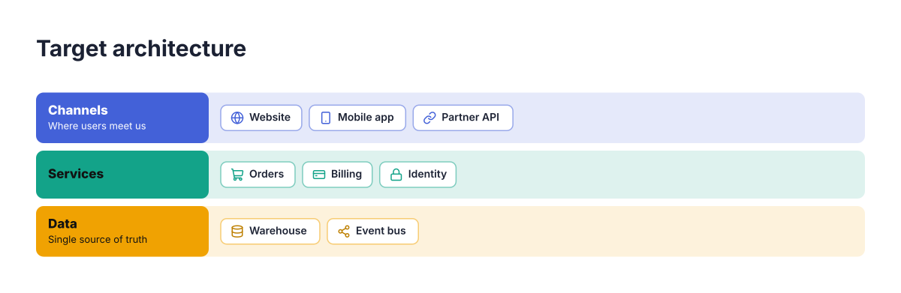

## Venn diagram — `venn:circles`

Two or three overlapping sets with their labels outside the circles and an optional label for the shared centre.

- Header: `@venn  or  @venn style:circles` (aliases: @venn1)
- Elements: 1 to 3 (best with 2 to 3)
- Good for: sweet spot; skills overlap; product–market fit

Element lines:
- `set "title" "subtitle"` (aliases: circle, group): One set

Settings (at most once):
- `center "text"`: Label of the area shared by all sets

Example:

```mplate
@venn "Where innovation happens"
  center "Innovation"
  set "Desirable" "People want it"
  set "Feasible" "We can build it"
  set "Viable" "It makes money"
```

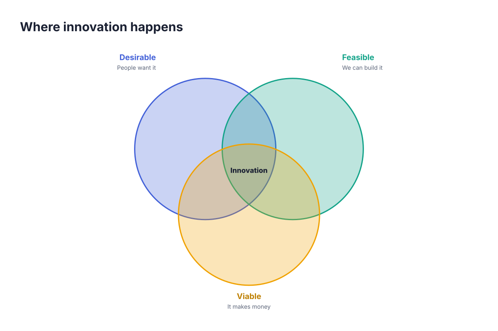
